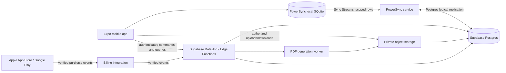

# Litterly V2 Architecture Recommendations

**Status: Proposed, not approved.** This repository currently contains product requirements only. No application framework, backend, database, deployment environment, or team constraints are present in code. This document recommends a candidate architecture for evaluation; it does not claim that the stack has been selected.

## Context

The MVP is an iOS and Android mobile product. Essential structured litter work must function offline, while kennel data, buyer applications, health records, and documents require strict tenant and audience boundaries. Payment-gated birth registration must remain safe across offline use and ownership transfer. See the [business requirements index](../litterly-v2-business-requirements.md) and its linked domain requirements.

## Recommended Starting Point

| Concern | Candidate | Rationale | Status |
| --- | --- | --- | --- |
| Mobile app | Expo + React Native + TypeScript | One mobile codebase for iOS and Android; PowerSync documents a React Native/Expo client SDK. The native PowerSync SQLite adapter requires a custom development build rather than Expo Go. | Recommended; confirm team expertise and prove native build compatibility. |
| Primary database/API | Supabase Postgres and its Data API | Relational constraints and transactions suit kennel ownership, parent/offspring relationships, application matching, and entitlements. Supabase provides Postgres, Auth, Storage, and Edge Functions. | Recommended; confirm data residency, privacy terms, operational support, and cost. |
| Authentication | Supabase Auth | Supports email and social sign-in including Apple and Google. Authorization remains an application/database concern; sign-in alone does not grant kennel access. | Recommended; confirm exact email flow and provider setup. |
| Authorization | Postgres Row Level Security (RLS), with narrowly scoped server functions for sensitive workflows | Enforces data access at the database boundary for user-scoped requests. Every exposed table and file operation needs explicit policies and negative tests. | Required design; policy implementation must be reviewed and tested. |
| Offline replication | PowerSync with local SQLite on the device | Provides local SQLite, offline reads/writes, and server-to-client synchronization with Supabase/Postgres. A proof of concept is required for access revocation, conflicts, write path, and regional requirements. | Recommended; not approved until the proof of concept succeeds. |
| Private file storage | Supabase Storage private buckets, metadata and share grants in Postgres | Keeps files separate from relational data while using database-backed access policies. Buyer access must be explicitly granted and short-lived download access used. | Candidate; validate revocation, file processing, limits, and operational requirements. |
| Billing | App Store / Google Play in-app purchase path; evaluate RevenueCat as an integration layer | The product sells digital app functionality. Store policies generally require their billing systems, subject to regional/program exceptions. A server-owned kennel entitlement ledger is still needed. | Provider and product mapping undecided; policy/legal review required. |
| PDF generation | Server-side document-generation component invoked only after authorization | Avoids exposing template-processing credentials and produces a private artifact with provenance. DOCX/PDF fidelity must be proven with representative templates. | Candidate; choose runtime/library after format test. |

The stack recommendation deliberately avoids selecting a client-side state-management library, ORM, analytics vendor, email/push vendor, or CI provider before product and team needs are known.

## System Shape

PowerSync is a synchronization/data-replication component, not the source of truth and not an authorization substitute. Postgres is authoritative for persisted business state and entitlements. The app may show locally accepted work before it is server-confirmed, but must label that state accurately.

PowerSync's Supabase integration reads Postgres through a replication role. Scope the Postgres publication to only required tables and treat the replication credential as highly privileged. Sync Streams must mirror the intended user read scope, but they do not replace RLS on the app-facing API or server-side write validation.

## Architectural Rules

- Every kennel-owned row has an explicit kennel boundary. External breeding partner profiles are scoped to the kennel that created them; they are not globally shared records.
- Buyer visibility is relationship-based and narrower than kennel membership. It is limited to the buyer's own applications, explicitly published updates, matched-animal information, and documents shared for that animal.
- Keep authorization checks close to data. RLS protects rows and Storage objects; server-side domain commands enforce transactional invariants such as unique active matches and payment-gated births.
- Treat the local database as a cache plus pending-work store. It is not authoritative for membership, entitlements, or successful server persistence.
- Keep provider purchase events separate from product entitlements. Verified provider events update a kennel-owned entitlement ledger idempotently.
- Do not expose Supabase secret/service-role credentials or payment-provider secrets in the mobile app.
- Prefer a modular monolith initially: one mobile application and one managed backend with clear domain boundaries. Do not split into microservices for the MVP without measured need.

## Decision Documents

- [Domain and data model](domain-and-data-model.md)
- [Security and access model](security-and-access.md)
- [Offline and synchronization design](offline-and-sync.md)
- [Billing, files, and background work](billing-files-and-background-work.md)
- [Decision register and validation gates](decision-register.md)
- [Implementation plan](implementation-plan.md)

## Recommended Next Step

Build a time-boxed technical proof of concept before approving this architecture. It should prove: Expo builds on supported iOS and Android targets with the PowerSync native adapter; authorized kennel-scoped data syncs into SQLite; a locally created birth remains pending until an authenticated, idempotent server command resolves entitlement; same-field conflicts are surfaced for review; buyer-specific rows/files do not leak; and account removal/revocation behavior is understood on a device that reconnects after being offline.

The [implementation plan](implementation-plan.md) sequences this proof of concept and makes later delivery conditional on its exit criteria and the blocking decisions in the [business open questions](../litterly-v2/open-questions-and-proposed-requirements.md).

## References

- [Supabase features](https://supabase.com/docs/guides/getting-started/features)
- [Supabase Row Level Security](https://supabase.com/docs/guides/database/postgres/row-level-security)
- [Supabase Storage access control](https://supabase.com/docs/guides/storage/security/access-control)
- [PowerSync React Native and Expo SDK](https://docs.powersync.com/client-sdks/reference/react-native-and-expo.md)
- [PowerSync Supabase integration](https://docs.powersync.com/integration-guides/supabase.md)
- [Apple App Review Guidelines, Business](https://developer.apple.com/app-store/review/guidelines/#business)
- [Google Play Payments policy](https://support.google.com/googleplay/android-developer/answer/9858738)
- [RevenueCat documentation](https://www.revenuecat.com/docs/)
